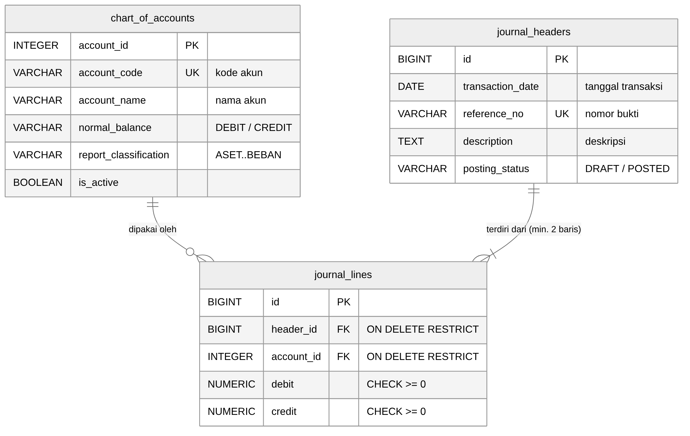

# Soal 1: Desain Arsitektur Data, Normalisasi & Penegakan Asas Berpasangan

File terkait: `soal1/01_schema_general_ledger.sql`, `soal1/02_uji_soal1.sql`, `soal1/erd.mmd`, `soal1/erd.png`, `bukti/uji_soal1.txt`

## 1.1 Perancangan Skema Relasional (ERD)



Relasi antar entitas:

| Relasi | Kardinalitas | Arti |
|---|---|---|
| `journal_headers` → `journal_lines` | 1 : N (minimal 2) | Satu bukti transaksi terdiri dari beberapa baris debit/kredit. Jurnal yang di-POSTED wajib punya minimal 2 baris (satu sisi debit, satu sisi kredit). |
| `chart_of_accounts` → `journal_lines` | 1 : N (boleh 0) | Satu akun bisa dipakai oleh banyak baris jurnal. Akun yang belum pernah dipakai tetap sah. |

`journal_lines` adalah **tabel asosiatif**, artinya tabel penghubung antara bukti transaksi dan akun. Setiap barisnya menjawab pertanyaan: "pada bukti X, akun Y didebit/dikredit sebesar berapa?"

Keputusan desain yang penting:
- `account_code` dan `reference_no` diberi **UNIQUE**, sehingga kode akun dan nomor bukti tidak bisa ganda.
- `normal_balance` disimpan per akun karena ada **akun kontra**. Contohnya Akumulasi Penyusutan termasuk ASET tetapi saldo normalnya KREDIT. Jadi saldo normal tidak bisa ditebak hanya dari kelompok akunnya.
- Jenis laporan (Neraca/Laba Rugi) **tidak disimpan** sebagai kolom karena bisa diturunkan dari `report_classification` lewat view `v_chart_of_accounts`. Kalau disimpan, akan muncul ketergantungan transitif yang melanggar 3NF.

## 1.2 Kekangan Integritas (DDL PostgreSQL)

DDL lengkap ada di `soal1/01_schema_general_ledger.sql`. Inti tabel `journal_lines`:

```sql
CREATE TABLE journal_lines (
    id         BIGINT GENERATED ALWAYS AS IDENTITY,
    header_id  BIGINT        NOT NULL,
    account_id INTEGER       NOT NULL,
    debit      NUMERIC(18,2) NOT NULL DEFAULT 0,
    credit     NUMERIC(18,2) NOT NULL DEFAULT 0,
    CONSTRAINT pk_journal_lines PRIMARY KEY (id),
    CONSTRAINT fk_lines_header  FOREIGN KEY (header_id)
        REFERENCES journal_headers (id) ON DELETE RESTRICT,
    CONSTRAINT fk_lines_account FOREIGN KEY (account_id)
        REFERENCES chart_of_accounts (account_id) ON DELETE RESTRICT,
    CONSTRAINT ck_lines_debit_nonneg  CHECK (debit  >= 0),
    CONSTRAINT ck_lines_credit_nonneg CHECK (credit >= 0),
    CONSTRAINT ck_lines_not_both_zero CHECK (NOT (debit = 0 AND credit = 0)),
    CONSTRAINT ck_lines_one_side      CHECK (NOT (debit > 0 AND credit > 0))
);
```

**Nilai tambah: keseimbangan Debit = Kredit ditegakkan di database.** CHECK constraint hanya bisa melihat satu baris, padahal keseimbangan jurnal melibatkan banyak baris. Karena itu dipakai `CONSTRAINT TRIGGER ... DEFERRABLE INITIALLY DEFERRED` yang menghitung `SUM(debit)` dan `SUM(credit)` per jurnal **saat COMMIT**. Ini langsung menutup celah pada kasus soal: transaksi yang dikirim lewat API tanpa melalui frontend tetap ditolak database. Selain itu, header wajib dibuat sebagai `DRAFT` dan hanya bisa diubah ke `POSTED` bila punya minimal 2 baris yang seimbang.

**Hasil uji** (`bukti/uji_soal1.txt`, dijalankan di PostgreSQL 16):

| No | Skenario | Hasil |
|---|---|---|
| 1 | Jurnal seimbang 500.000 = 500.000 | ✅ Tersimpan & POSTED |
| 2 | Jurnal tidak seimbang (750.000 vs 700.000) dikirim langsung | ❌ Ditolak saat COMMIT: *"Jurnal tidak seimbang"* |
| 3 | Debit negatif | ❌ Ditolak `ck_lines_debit_nonneg` |
| 4 | Debit & kredit sama-sama 0 | ❌ Ditolak `ck_lines_not_both_zero` |
| 5 | Hapus akun Kas yang sudah dipakai | ❌ Ditolak `fk_lines_account` (RESTRICT) |
| 6 | Hapus header yang punya baris | ❌ Ditolak `fk_lines_header` (RESTRICT) |
| 7 | Posting jurnal tanpa baris | ❌ Ditolak aturan posting |
| 8 | Akun yang tidak ada di bagan akun | ❌ Ditolak foreign key |

## 1.3 Analisis Audit & Keamanan Finansial: Header-Line vs Tabel Tunggal

Model tabel tunggal (flat), misalnya `jurnal(no_bukti, tanggal, deskripsi, akun_debit, akun_kredit, nominal)` atau satu baris per akun yang mengulang tanggal dan deskripsi, punya kelemahan berikut dibandingkan model Header-Line.

**a. Dari sisi normalisasi (3NF)**
- Pada tabel flat, `tanggal`, `deskripsi`, dan `status` bergantung pada `no_bukti`, bukan pada kunci baris jurnal. Ini **ketergantungan parsial/transitif** yang melanggar 2NF/3NF, karena atribut header diulang di setiap baris.
- Pengulangan data memicu **anomali**:
  - *Anomali update*: tanggal diubah di satu baris tetapi tidak di baris lain, sehingga satu bukti punya dua tanggal.
  - *Anomali insert*: bukti tidak bisa dicatat tanpa baris akun.
  - *Anomali delete*: menghapus satu baris akun bisa membuat sisa jurnal tidak seimbang tanpa terdeteksi.
- Pada model Header-Line, atribut bukti disimpan **sekali** di `journal_headers`, sedangkan `journal_lines` hanya berisi atribut yang bergantung penuh pada barisnya (akun, debit, kredit). Model ini memenuhi 3NF.

**b. Dari sisi jejak audit (audit trail)**
- **Satu bukti = satu identitas.** Auditor bisa menelusuri dari laporan keuangan → buku besar → baris jurnal → header → nomor bukti fisik (vouching), lalu sebaliknya (tracing). Nomor bukti yang `UNIQUE` mencegah bukti ganda dan memudahkan uji kelengkapan urutan nomor.
- **Keseimbangan bisa diuji per transaksi.** `SUM(debit) = SUM(credit) GROUP BY header_id` bisa ditegakkan otomatis (constraint trigger di atas). Pada tabel flat dengan pola "akun_debit/akun_kredit/nominal", jurnal majemuk (satu debit, banyak kredit) harus dipecah sehingga keterkaitannya hilang. Pada pola satu-baris-per-akun tanpa header, tidak ada kunci yang andal untuk mengelompokkan baris.
- **Status dan otorisasi melekat pada header.** Status `DRAFT/POSTED`, pembuat, waktu, dan checksum (Soal 3.2) cukup dicatat sekali di header dan berlaku untuk seluruh barisnya. Penguncian jurnal yang sudah POSTED dan koreksi lewat jurnal pembalik menjadi sederhana dan konsisten.
- **Integritas referensial.** `ON DELETE RESTRICT` mencegah akun atau bukti terhapus selama masih punya riwayat transaksi, sehingga tidak ada "baris yatim" yang menghilangkan jejak.
- **Pengendalian internal.** Validasi tidak bergantung pada frontend. Seluruh aturan (CHECK, FK, keseimbangan, aturan posting) berada di lapisan basis data yang dipakai bersama oleh semua kanal (web, API, impor), sesuai prinsip *defense in depth*.

**Kesimpulan:** model Header-Line lebih andal karena menghilangkan redundansi (3NF), memungkinkan pengujian keseimbangan per bukti, dan memberi titik tunggal untuk status, otorisasi, dan jejak audit. Model ini mencegah kasus *unbalanced balance sheet* yang dialami sistem lama.
